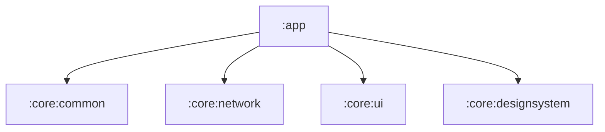
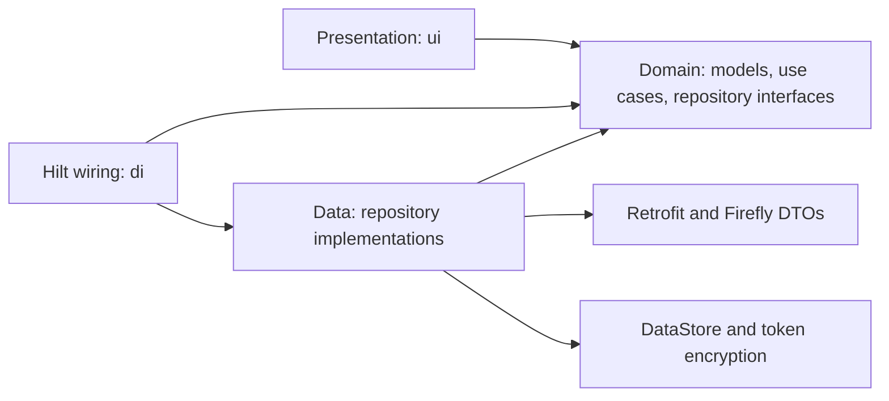
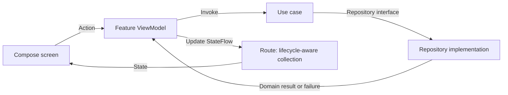
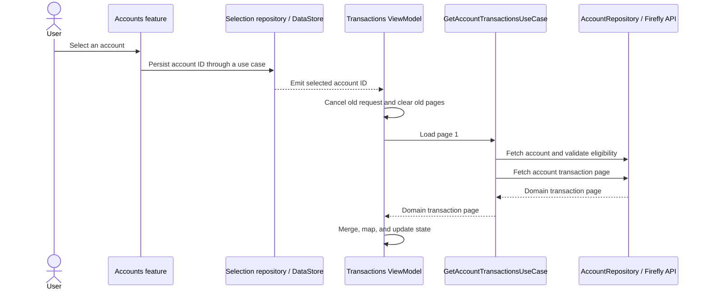

# Architecture

## Overview

Brutus Fly is a native Android client for Firefly III, built with Kotlin and Jetpack Compose. It uses a layered architecture with repository interfaces, use cases, and an MVI-style presentation layer.

Business features live in the `app` module. Shared infrastructure is extracted into small `core` modules. Presentation is organized by screen, while domain and data packages are organized by responsibility and subject area.

This document describes the current implementation, rather than a proposed architecture.

## Modules and dependencies

Arrows below represent Gradle project dependencies, not the order in which requests execute.



| Module | Responsibility | Boundary |
| --- | --- | --- |
| `app` | Application entry points, navigation, features, business rules, Firefly integration, persistence, and dependency wiring | Composes the application from the shared modules |
| `core/common` | `Mapper`, `MappingException`, and synchronous/asynchronous use case contracts | Pure Kotlin/JVM; no Android or feature dependencies |
| `core/network` | Generic transport results, errors, and Retrofit call adapters | Pure Kotlin/JVM; no Firefly-specific models, persistence, or UI |
| `core/ui` | `BaseViewModel` and shared state/action/event infrastructure | Android library; no Compose, Hilt, or feature dependencies |
| `core/designsystem` | Compose components, themes, typography, spacing, shapes, and previews | Android/Compose library; no business or data dependencies |

The core modules do not depend on one another. Domain and data are **packages within `app`**, not separate Gradle modules, so their layer boundaries are conventions rather than independently enforced build boundaries.

## Application package organization

The base application package is `william.miranda.brutusfly`. All paths in this section are relative to `app/src/main/java/william/miranda/brutusfly/`.

```text
brutusfly/
├── BrutusFlyApplication.kt
├── di/
├── ui/
│   ├── MainActivity.kt
│   ├── main/
│   ├── navigation/
│   ├── setup/
│   ├── accountlist/
│   ├── transactionlist/
│   ├── categorylist/
│   └── common/category/
├── domain/
│   ├── model/
│   ├── repository/
│   └── usecase/
└── data/
    ├── repository/
    ├── mapper/
    ├── remote/
    │   └── dto/
    ├── local/datastore/
    └── security/
```

### Presentation: `ui`

The presentation layer renders application state and translates user interactions into actions. It accesses business operations through use cases, not Retrofit or DataStore directly.

| Package | Responsibility |
| --- | --- |
| `ui/main` | Chooses between loading, server setup, configuration failure, and the main application; hosts the bottom navigation |
| `ui/navigation` | Serializable Navigation 3 destination keys |
| `ui/setup` | Collects and validates server connection input through the configuration use case |
| `ui/accountlist` | Loads account pages, displays balances, and persists account selection |
| `ui/transactionlist` | Observes the selected account, loads its transactions, and manages search, filters, and daily sections |
| `ui/categorylist` | Loads and searches categories and manages local icon choices |
| `ui/common/category` | Shared category icon catalog, visual mappings, and decorative colors used across screens |

Features use the following roles where needed:

- **`*Contract.kt`:** immutable state, user actions, and feature-specific errors or events.
- **`*Route.kt`:** obtains the ViewModel through Hilt and collects state with lifecycle awareness.
- **`*Screen.kt`:** renders state and sends actions through callbacks, without owning data access.
- **`*ViewModel.kt`:** handles actions, launches use cases, coordinates asynchronous work, and updates state.
- **`components/`:** feature-specific composables, such as account cards and transaction filters.
- **`model/` and `mapper/`:** presentation models and domain-to-UI conversion, including formatting and grouping.

Reusable visual primitives belong in `core/designsystem`; business-specific components remain in the feature.

### Domain: `domain`

The domain layer describes application concepts and operations without exposing HTTP DTOs, Compose types, or DataStore preferences.

| Package | Responsibility |
| --- | --- |
| `domain/model` | Accounts, categories, transaction groups/splits, page boundaries, configuration, and typed failures |
| `domain/repository` | Interfaces describing the data operations and observable preferences needed by use cases |
| `domain/usecase` | Application operations, such as loading accounts, selecting an account, configuring a server, or validating account eligibility |

Subpackages group related concepts: `account`, `category`, `categoryicon`, `selectedaccount`, `serverconfiguration`, and `transaction`, as applicable.

Use cases are intentionally small. Some delegate directly to repositories; others coordinate rules. For example, `GetAccountTransactionsUseCase` checks that an account is active and selectable before loading page one, including refreshes and retries.

### Data: `data`

The data layer implements domain repository interfaces and owns external representation details.

| Package | Responsibility |
| --- | --- |
| `data/repository` | Coordinates remote/local sources, maps responses, validates returned identities/pages, and translates failures into domain errors |
| `data/mapper` | Converts DTOs, API errors, input values, and saved preference representations; organized by subject area |
| `data/remote` | Firefly Retrofit endpoints, configured API delegation, API client creation, and authentication restrictions |
| `data/remote/dto` | Serializable Firefly request/response representations, separate from domain models |
| `data/local/datastore` | Store interfaces and DataStore implementations for connection settings, selected account ID, and category icon assignments |
| `data/security` | `TokenCipher` abstraction and Android Keystore-backed token encryption |

`ConfiguredFireflyApi` reads the saved connection configuration before delegating each API operation. `FireflyApiFactory` can also create a client for credentials that have not yet been saved, allowing setup to verify the server first.

### Composition root: `di`

Hilt connects interfaces to implementations:

- **`NetworkModule`:** provides JSON configuration, the shared OkHttp client, and the configured `FireflyApi` implementation.
- **`RepositoryModule`:** binds domain repository interfaces to data implementations.
- **`StorageModule`:** provides the shared DataStore and binds local stores and the token cipher.

`BrutusFlyApplication` initializes Hilt, and `MainActivity` hosts the Compose application.

## Layer boundaries

The following diagram shows code dependencies inside `app`. A repository implementation depends on the domain interface it implements; the domain does not depend on the concrete implementation.



Conversions occur at explicit boundaries:

```text
Firefly JSON → DTOs → domain models → presentation models → Compose
Transport errors → domain failures → feature state → user feedback
```

`ApiResult` and HTTP metadata stay behind the repository boundary. Financial amounts use `BigDecimal`; presentation preserves currency distinctions rather than combining amounts from different currencies.

## State and interaction flow

`BaseViewModel<STATE, ACTION, EVENT>` exposes read-only `StateFlow` state, an `onAction` entry point, and an optional channel-backed event stream.



The return arrow summarizes the result flowing back through the use case; it is not a direct repository-to-ViewModel dependency.

ViewModels initialize work explicitly, normally in `init`, and own coroutines through `viewModelScope`. State updates are atomic and their transformations must be pure. Durable information belongs in state or persistence, not transient events: the event channel is not a broadcast or exactly-once delivery mechanism.

## Main runtime flows

### Startup and server configuration

1. `MainViewModel` observes whether a configuration exists.
2. `MainAppRoute` displays loading, setup, the main application, or configuration-read recovery.
3. Setup delegates to a configuration use case and repository, which validate the input and call `GET api/v1/about`.
4. Credentials are saved only after verification succeeds. The main application starts on **Accounts**, with **Transactions** and **Categories** available in the bottom bar.

### Account selection and transaction loading



The Accounts feature initializes the first selectable account only when no selection exists. Transactions observes the persisted ID rather than receiving a separate navigation argument.

The Transactions ViewModel retains accepted domain groups in memory, deduplicates overlapping pages by group ID, and rebuilds daily UI sections. A generation counter prevents responses from an earlier account selection from changing the current account's state.

Search and filters are local to loaded pages. Category options load independently, and persisted icon changes can update transaction presentation without fetching transactions again. Refresh and next-page loading have separate state, preserving existing results on recoverable failures.

### Local persistence and security

One DataStore holds the server URL, encrypted token, selected account ID, and category icon assignments. It is a preferences store, **not an offline cache of financial records**.

Tokens use AES-GCM encryption with an Android Keystore-managed key. HTTPS is required, authenticated redirects are disabled, and requests are restricted to the configured origin and installation path.

Changing the server URL or token atomically clears connection-scoped preferences. Saving the same credentials preserves local choices; resetting configuration clears the preferences without deleting the encryption key.

## Current scope and limitations

- Features remain in `app`; there are no separate per-feature Gradle modules.
- The active Transactions screen uses `AccountRepository` and the account-scoped endpoint. The global transaction repository and use case remain available but are not used by this screen.
- The transaction presentation mapper currently supports deposits and withdrawals. Transfers, reconciliation, and opening balances produce a mapping failure rather than being silently omitted.
- Account and transaction pages are fetched from Firefly III; there is no background synchronization or persistent financial-record database.
- Navigation defines a `Summary` destination key, but the current main UI exposes only Accounts, Transactions, and Categories.

## Tests and further reading

Local tests live in module `src/test` directories; Android-dependent tests live in `app/src/androidTest`. Tests cover areas such as mapping, repositories, use cases, ViewModel behavior, transport adaptation, token encryption, and theme contrast. Test files alone do not imply that the current suite has been executed successfully.

For more focused implementation notes, see:

- [Account listing and selection](docs/account-list.md)
- [Server configuration and security](docs/server-configuration.md)
- [Transaction pagination](docs/transaction-pagination.md)
- [Shared UI infrastructure](core/ui/README.md)
- [Design system](core/designsystem/README.md)
- [Network transport contract](core/network/README.md)
